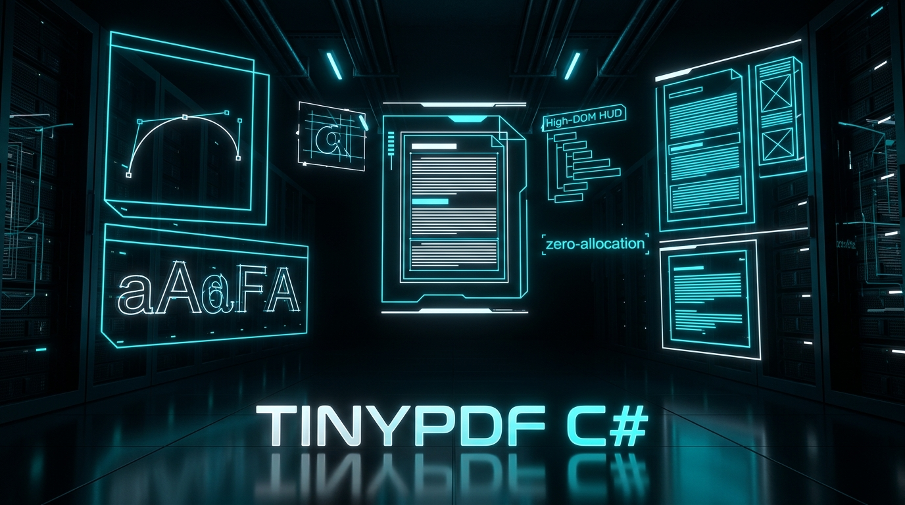
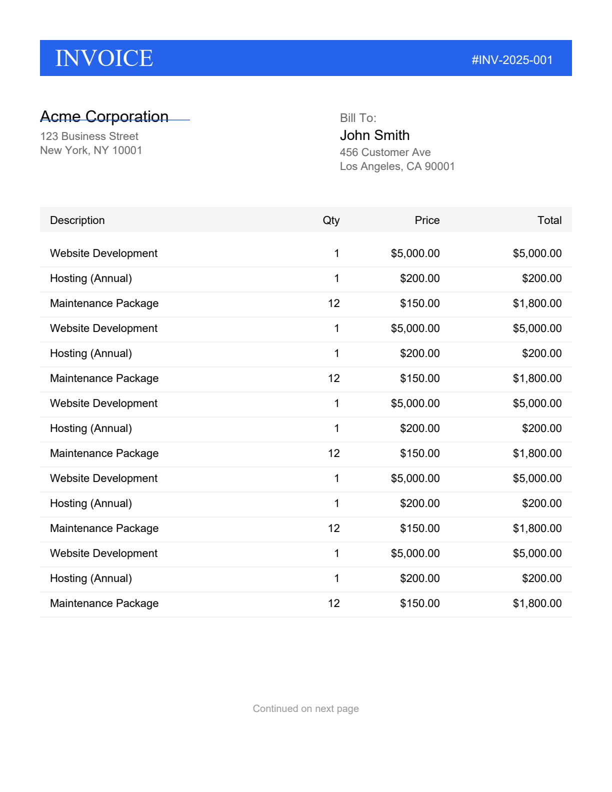
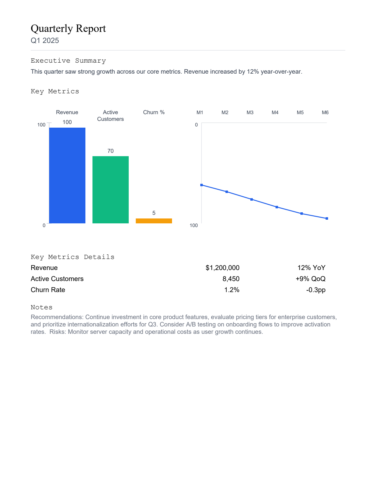
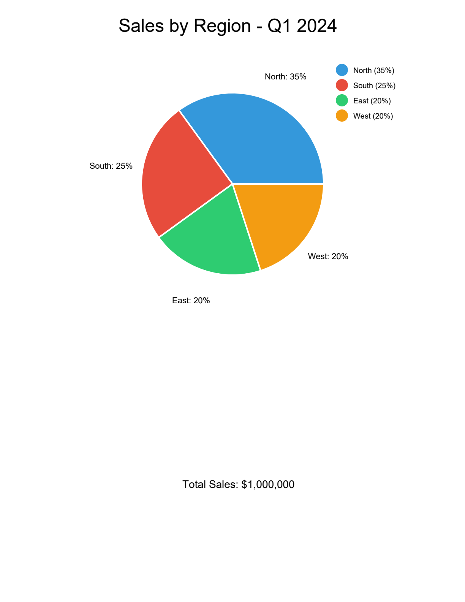

# TinyPdf C#

[](https://dev.to/iancowley/i-built-a-minimal-zero-dependency-pdf-library-for-c-because-i-hate-bloat-58b1)
[](https://www.nuget.org/packages/TinyPdf/)
[](https://glaciersoftware.dev/)
[](https://buymeacoffee.com/glaciersoftware)

> 📖 **Read the Deep-Dive**: **[I built a minimal zero-dependency PDF library for C# because I hate bloat.](https://dev.to/iancowley/i-built-a-minimal-zero-dependency-pdf-library-for-c-because-i-hate-bloat-58b1)**

A minimal, Native AOT-compatible PDF creation library for .NET 10, ported from the original [tinypdf](https://github.com/Lulzx/tinypdf) by Lulzx.

## Features
- Zero external dependencies & Native AOT ready (`IsAotCompatible`)
- Text rendering (`Helvetica`, `Times`, `Courier` + bold/oblique variants) with full `WinAnsiEncoding` typographic support (`€`, `£`, `—`, `–`, `•`, smart quotes, ellipsis)
- Clickable links with optional underlining
- Shapes (Rectangles, Lines, Circles, Wedges)
- JPEG images (`/DCTDecode` passthrough preserved under Flate compression)
- Optional Flate (deflate) compression for PDF page streams
- Markdown to PDF conversion
- Multiple pages with custom sizes

## Supported framework
This project targets `.NET 10`.

## Installation
Install the package via the .NET CLI:

```bash
dotnet add package TinyPdf
```

---

## 📄 Sample Outputs: Real Rendered PDF Previews

All sample documents below are generated programmatically using `TinyPdf` (pure C#, zero dependencies) in sub-millisecond execution times:

| Automated Business Invoice (~320 Ops) | Multi-Section Analytics Report (~56 Ops) |
| :---: | :---: |
|  |  |
| *Vector layout, dynamic line item tables, currency formatting, and totals (0.33 ms / doc)* | *Headings, structured grids, shaded backgrounds, and metric summaries (0.06 ms / doc)* |

| Vector Wedge Pie Chart (~20 Ops) | POS Thermal Receipt (~18 Ops) |
| :---: | :---: |
|  |  |
| *Precise mathematical arc and wedge vector slices with color fills (0.05 ms / doc)* | *Compact monospace thermal receipt layout with barcodes and itemization (0.04 ms / doc)* |

---

## Usage

### Simple PDF
```csharp
using TinyPdf;

var builder = TinyPdfCreate.Create();

builder.Page(ctx => {
    ctx.Text("Hello World", 50, 700, 24);
    ctx.Rect(50, 650, 100, 20, "#FF0000");
});

byte[] pdf = builder.Build();
File.WriteAllBytes("output.pdf", pdf);
```

### Markdown to PDF
```csharp
using TinyPdf;

var options = new TinyPdfCreate.MarkdownOptions(Compress: true);
string md = "# Header\n\nThis is a paragraph — €100.\n\n- List item";
byte[] pdf = TinyPdfCreate.Markdown(md, options);
File.WriteAllBytes("markdown.pdf", pdf);
```

## Running tests
From the repository root run:

```bash
dotnet test
```

---

## 🆕 What's New in v0.2.0

- **CRITICAL BUG FIX: Preserved `/Filter /DCTDecode` on JPEG XObjects when `Compress = true`** — `Builder.Build()` previously overwrote `/Filter /DCTDecode` with `/FlateDecode` and ZLib-compressed raw JPEG bytes, corrupting embedded images whenever stream compression was enabled.
- **Full `WinAnsiEncoding` Typographic Serialization** — mapped all Windows-1252 extended code points (`€`, `—`, `–`, `“`, `”`, `‘`, `’`, `•`, `…`, `™`, etc.) to their exact single-byte WinAnsi values and transliterated common arrows/math operators (`→`, `≥`, `≤`), eliminating UTF-8 mojibake in Type 1 fonts.
- **Hardened JPEG SOF0/SOF1/SOF2 Header Bounds Check** and enabled **`IsAotCompatible` + `TreatWarningsAsErrors`** with NuGet Trusted Publishing OIDC.

---

## Credits

Developed by Ian Cowley and Antigravity (Google DeepMind).

---

## ❄️ Glacier Ecosystem & Support

Part of the **[Glacier Ecosystem](https://glaciersoftware.dev/)** — high-performance, zero-allocation developer tooling and data engines natively built for modern C# and .NET 10.

* 🌐 **Website & Documentation**: [glaciersoftware.dev](https://glaciersoftware.dev/)
* ☕ **Buy Me a Coffee**: [buymeacoffee.com/glaciersoftware](https://buymeacoffee.com/glaciersoftware)
* ❤️ **GitHub Sponsors**: [github.com/sponsors/ian-cowley](https://github.com/sponsors/ian-cowley)
* 🐙 **All Repositories**: [github.com/ian-cowley](https://github.com/ian-cowley)
